# Transient performance of a brushless LV alternator against ISO 8528-5 G3

**Systems-engineering dossier, revision 1.0 (10 Nov 2026).** All tables marked "generated" are written from
`results/*.json` by `scripts/make_tables.py`; no result number is typed by hand.

**Central question.** Can a given 800 kVA, 400 V, 50 Hz, 4-pole brushless alternator, with its exciter and AVR,
meet the ISO 8528-5 performance class G3 voltage limits when a block load is applied or a large induction motor
is started direct-on-line? Which design or AVR parameters decide that?

**Short answer.** Only just, and not robustly. On FEMM-derived parameters the reference machine meets the G3 block-load
dip: −14.7 % against −15 % with the retuned shunt AVR (A1). Once the AVR is retuned it also meets the 4 s recovery
(0.97 s). It fails two of the six "shalls":
- the 132 kW direct-on-line motor start, at −22.9 % against −20 % (the largest motor within −20 % is 111 kW);
- with shunt excitation, the sustained fault current, at 0.04 pu against 3 pu.

**The deciding parameter is the transient reactance X'd.** It is 0.256 pu here. SR-01 allows at most 0.263 pu and
the motor start at most 0.214 pu. The AVR, a larger exciter and a PMG change the recovery and the fault current; they
move the first dip by no more than 0.3 percentage points. Only the next frame meets every shall, and only together
with a PMG (A5).

**How to read the evidence.** Every engineering value carries a tag:
- **[S]** sourced, with a reference in §12;
- **[D]** derived in this study, with the model and file named;
- **[A]** assumed, a typical order of magnitude.

Every [A] value that could change a conclusion is varied in §8.4. The method follows Wasson, *System Engineering
Analysis, Design, and Development*, 2nd ed., Wiley 2016 [W]. Page numbers are the printed ones; the PDF page is the
printed page + 30. Other textbooks [T1]–[T5] were not available to re-check equation numbers, so their equations are
written out and derived in `docs/design_notes.md` instead of being cited by number (§11).

---

## 0. Findings

Numbers are from `results/aoa_femm.json`, `results/studies_femm.json`, `results/params_femm.json` and
`results/a3_ceiling_femm.json`. All are on FEMM-derived parameters.

1. **FEMM and the analytic design agree within 8 % on everything except the damper.** Xd −8 %, Xq −8 %, X'd −3 %,
   T'do −5 %, no-load field current +8 % (FEMM vs analytic). X''d is 43 % higher in FEMM: 0.207 against 0.145 pu.
   The reasons are in §6.1: the analytic cage referral spreads the bars over the whole pole arc, and FEMM resolves the
   leakage of the bar slits.
2. **The first dip is almost all reactance.** Of the −14.7 % block-load dip, −12.6 points are already there at
   t = 0⁺ with the rotor fluxes frozen. The real excitation adds −2.1 points. The excitation option moves the total
   only between −14.4 % (A2) and −14.7 % (A1).
3. **The SR-01 margin is 0.3 points and fragile.** Any one of the following breaks it on its own (§8.4):
   - X'd +20 %;
   - X''d +20 %;
   - exciter TE = 0.40 s;
   - VRMAX = 10 pu;
   - damper time constants halved, which stands in for real end-ring resistance (FEMM rings are ideal): −15.05 %.
4. **Recovery is an AVR-tuning problem, and it is solved.** The textbook pole-cancellation PID (A0) takes 5.25 s and
   fails SR-02. The grid-tuned PID recovers in 0.97 s with a 6 % open-circuit step overshoot (DR-03 holds).
5. **The motor start decides the frame.** With the base frame, a 132 kW DOL start dips by −22.3 % (PMG) to −22.9 %
   (shunt). The largest motor within −20 % is 111–115 kW; on the next frame it is 151–156 kW. To start 132 kW within
   −20 %, X'd must be at most 0.214 pu (shunt) or 0.221 pu (PMG).
6. **The fault-current shall decides the excitation.** Shunt excitation collapses to 0.04 pu at 1 s. The PMG
   sustains 2.92 pu, 2.7 % short of 3 pu. An AVR ceiling 4.4 % higher (VRMAX 14.6 instead of 14.0 pu, an assumed
   value, D5) closes the gap.
7. **The root cause is the reference design's X'd, not the excitation.** A machine with data-sheet-class parameters
   (X'd = 0.17 pu, midpoints of [S7]) dips only −8.5 % on the same block load and −16.2 % on the 132 kW start, with
   the same shunt AVR. The study design's X'd of 0.256 pu is above the public range of 0.146–0.19 pu.
8. **A single open rotating diode silently breaks SR-01.** It derates the rectifier to 0.765, and the dip becomes
   −15.02 %. A shorted diode raises the exciter armature current 2.9× and the dip to −15.67 %. The 1×/6× f_ex
   ratio of the field-frame MMF rises from 0.002 (healthy) to 5.5 (open) and 42 (short), so the failure can be
   detected from the stationary side.
9. **Frequency is not the limit.** At a 50 % step on the generic turbo-charged engine, the frequency dips by −4.7 %
   (G3: −7 %) and recovers in 2.5 s (G3: 3 s). The engine adds 0.7–0.9 points to the voltage dip.
10. **Waveform.** The no-load line-to-line THD is 2.27 % with an unskewed stator (SR-07: 5 %). The largest
    harmonics are the 5th (1.94 %) and the 7th (0.99 %); the 2/3 pitch removes the triplens.

---

## 1. Need, problem space and stakeholders ([W] ch. 4–5)

**System of interest (SOI).** The alternator with its excitation system: main machine, brushless exciter, rotating
rectifier, AVR and AVR power source.

**Higher-order system.** The generating set: engine, governor, alternator and controls.

**Operating environment.** An islanded LV bus with two kinds of load:
- block loads: UPS, IT and HVAC blocks;
- direct-on-line motors: pumps and chillers.

**Stakeholders** ([W] Principle 4.3, p. 78: the customer and the customer's customer):

| Role | Who | What they need from the SOI |
|---|---|---|
| User (customer) | Generating-set packager | Certify the set to ISO 8528-5 G3 without oversizing the alternator |
| End user | Facility operator (e.g. a data-centre standby plant) | Loads ride through block loads and motor starts; downstream protection stays selective during faults |
| Developer | Alternator design and test engineering | Know which design or AVR parameter decides the answer before a frame is built and bench-tested |

**Problem statement** ([W] Principle 4.15, p. 91). Today an alternator is chosen from catalogue reactances and
motor-starting curves. When a set fails the transient test, there are two usual fixes, and both have a cost:
- a bigger frame, which adds material and size;
- re-tuning the AVR on site, which has no traceable basis.

The contributory causes ([W] Principle 4.16, p. 91) are not separated. Machine reactances, excitation forcing, AVR
dynamics and engine speed dip all lower the same voltage.

**Opportunity.** A model chain that is traceable from geometry to the ISO 8528-5 metrics:
1. FEMM field solution;
2. machine parameters;
3. dq dynamics with exciter, AVR and engine.

This chain splits the dip by cause and ranks the fixes on evidence.

**Measures** ([W] Principles 5.10–5.11, p. 115):
- MOE-1: transient voltage deviation on load application, δU_dyn⁻ (ISO 8528-5).
- MOE-2: voltage recovery time t_U.
- MOE-3: the largest DOL motor that can be started within the dip limit.
- MOS-1: relative cost.
- MOS-2: sustained short-circuit current, which keeps protection selective.
- MOS-3: frame size.

## 2. Concept of operations ([W] ch. 5–6)

**Mission phases** ([W] Principle 5.7, p. 110):

| Phase | Sub-phase | What matters for transient performance |
|---|---|---|
| Pre-mission | Factory routine test, type test, commissioning | OCC, field currents and AVR set-up. Bench link: the sister project *alternator-routine-test-station* (§10.3) |
| Mission | Start and voltage build-up | Shunt excitation builds up from remanence; PMG excitation gives voltage from the first revolution |
| | Load acceptance | Block steps. The first step is limited by the engine (ISO 8528-5 BMEP-based step) |
| | Steady supply | ±1 % voltage band (G3) |
| | Motor start | DOL start of the largest pump: low-PF current of about 6× rated for 1–3 s |
| | Load rejection | Breaker trip of a large block causes overvoltage |
| | Downstream fault | Three-phase short circuit. Fault current must be sustained long enough for selective tripping |
| Post-mission | Cool-down, shutdown | Not part of this study |

**UC-1 "accept block load"** ([W] Principles 5.12–5.23, pp. 120–122):
- Actors: generating-set controller, load breaker, AVR.
- Precondition: rated speed and voltage, no load.
- Trigger: the breaker closes on P + jQ.
- Main success scenario: the dip stays at or above −15 %, and the voltage is back within ±1 % within 4 s.

**UC-2 "start DOL motor"** is the same, with a motor in place of the block. **UC-3 "ride through a downstream
fault"**: the fault current stays at or above 3 pu until the downstream breaker clears.

## 3. Modes and states ([W] ch. 7)

| Mode ([W] Principle 7.4, p. 157) | Trigger into the mode (Principle 7.5, p. 159) | Allowable actions | Prohibited actions (Principle 7.10, p. 169) |
|---|---|---|---|
| M0 Off | Stop command | Maintenance, insulation test | Loading |
| M1 Run-up / build-up | Start; speed above the build-up threshold | — | Loading before the voltage is established |
| M2 No-load ready | Voltage within ±1 % | Close the load breaker | Paralleling without synchronising |
| M3 Loaded, steady | Load connected, transients settled | Further steps up to the engine step limit | A step larger than the declared acceptance |
| M4 Transient (dynamic state, Principle 7.9, p. 166) | Load step, motor start or rejection | AVR forcing up to the ceiling | A second step before recovery |
| M5 Fault sustain | Terminal voltage collapsed, high current | Hold excitation (PMG) for the selective trip | Over-excitation beyond its time limit |
| M6 Protected shutdown | Over-voltage, loss of excitation, diode failure | De-excite, alarm | Automatic restart |
| T Bench test | Factory test mode | Separate drive, test supplies | — |

**Configuration states** (Principle 7.7, p. 164):
- excitation source: shunt or PMG;
- AVR tuning set;
- frame: base or next size up.

**Environmental state** (Principle 7.8, p. 165): hot windings. Resistances are taken at 115 °C [A].

## 4. Requirements ([W] ch. 19–22)

Each requirement has the structure of Principle 22.5 (p. 449): subject, *shall*, action, outcome, condition. Each also
has a verification method from the set in Principle 22.4 (p. 448).

**Source of the G3 values.** They are the ISO 8528-5 performance class operating limits (ISO 8528-5:2018, clause 15;
ISO 8528-5:2022, Table 4) [S2]. The numbers were read through two manufacturer white papers that reproduce the table
[S5][S6], because the standard is paywalled; only its contents and definitions were seen [S2]. Before any external
use, check them against a purchased copy.

| ID | Requirement | Source | Allocated to | Verification |
|---|---|---|---|---|
| SR-01 | On application of rated kVA at 0.8 PF lagging in one step at rated speed, the alternator shall keep the transient voltage deviation at or above −15 % of rated voltage. | G3 value [S2][S5][S6]. The *full* single step is a mission assumption [A]: ISO applies −15 % to the engine's BMEP step, so SR-01 is stricter than the standard | Main machine, exciter, AVR | Analysis (here); Test (load bank) |
| SR-02 | After the SR-01 step, the voltage shall return to, and stay within, ±1 % of its steady value within 4 s. | G3 t_U and the recovery band: "returns to and remains within the steady-state voltage tolerance band" [S2 3.32–3.33]; band width 2·δU_st [S3, 1993 ed. 8.8] | AVR, exciter | Analysis; Test |
| SR-03 | On rejection of rated kVA at 0.8 PF, the transient voltage rise shall not exceed +20 %. | G3 [S5][S6] | AVR, exciter | Analysis; Test |
| SR-04 | After SR-03, the voltage shall return within ±1 % within 4 s. | G3 [S5][S6] | AVR | Analysis; Test |
| SR-05 | During a DOL start of the declared largest motor (132 kW pump), the dip shall stay at or above −20 %. | ISO 8528-5 has no motor-start clause [S2]; G4 means "by agreement" [S6]. −20 % is a common specifier limit [S8][S9] | Main machine, excitation | Analysis; Test |
| SR-06 | For a bolted three-phase terminal fault, the alternator shall sustain at least 3 pu RMS current at 1 s. | Data-sheet practice for selective protection [A]; that shunt excitation does not sustain it is sourced [S7] | Excitation source | Analysis; Test |
| SR-07 | No-load line-to-line voltage THD shall not exceed 5 %. | IEC 60034-1 clause 9.11 THD [S4]. The clause is verified; the 5 % value is the usual figure but was **not** seen in the standard | Winding, pole shape | Analysis (FEMM); Test |
| SR-08 | Steady-state voltage shall stay within ±1 % from no load to rated load. | G3 [S5][S6] | AVR | Test |

**Derived requirements** ([W] Principle 21.2, p. 437; allocation by synthesis, Principle 31.5, p. 669). The values
are generated in §6.2 and §8.

| ID | Derived requirement | From |
|---|---|---|
| DR-01 | The main machine's X'd shall not exceed the value in the "largest X'd" table of §6.3, for the chosen excitation option. | SR-01, SR-05 via the X'd sweep |
| DR-02 | The excitation system shall have its ceiling, TE and KC within the ranges for which §8.4 shows SR-01/02 met. | SR-01, SR-02 |
| DR-03 | The AVR shall be tuned so that the 5 % open-circuit set-point step overshoots by 10 % or less, while meeting SR-02. | SR-02 + a stability design rule [A] (IEEE Std 421.2-style performance indices) |

**Technical performance measures** ([W] Principle 21.4, p. 442): X'd, X''d, T'do, the excitation ceiling, the SR-01
margin, the SR-02 margin and the largest motor at 20 %.

## 5. Architecture and interfaces ([W] ch. 26–27)

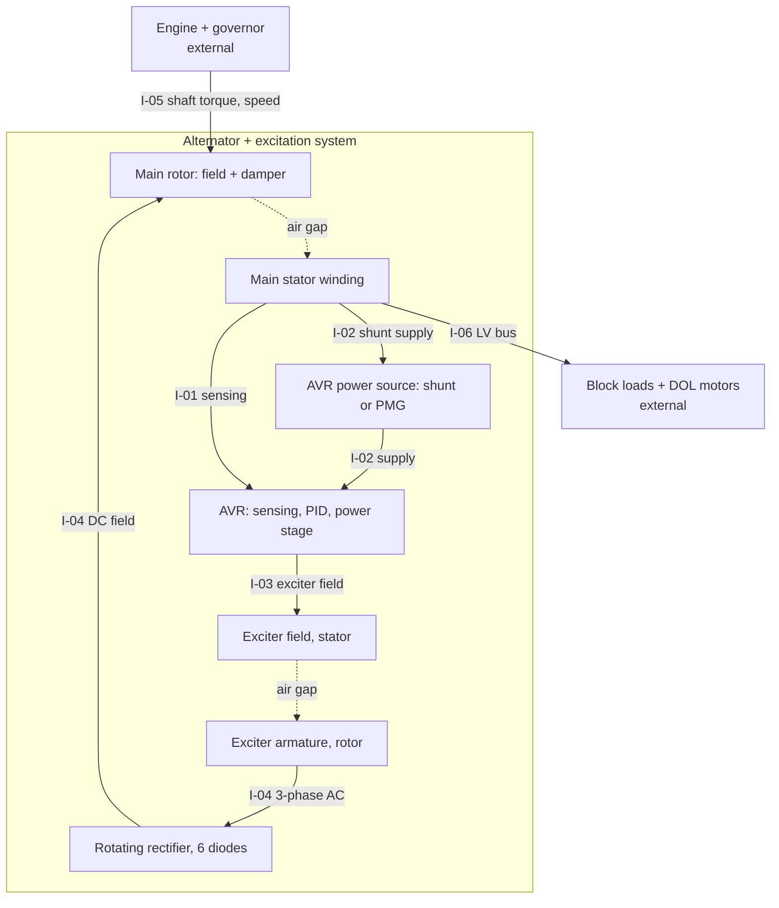

**Architecture principles applied.** Context, Principle 26.4 (p. 550); domain views, Principle 26.6 (p. 551);
selection rationale, Principle 26.10 (p. 553), which is the trade study in §8.

| ID | Interface | Definition | Owner |
|---|---|---|---|
| I-01 | Voltage sensing | 3-phase average RMS, filter TR = 10 ms [A] | AVR |
| I-02 | AVR supply | Shunt: ∝ terminal voltage, so the regulator ceiling scales with V_t (IEEE 421.5 AC8B note; AC7C/AC8C switch SW1 position A). PMG: independent of terminal conditions (SW1 position B) [S1] | Excitation |
| I-03 | Exciter field | VR ≤ VRMAX (pu), exciter field time constant TE | Exciter |
| I-04 | Rotating rectifier → main field | EFD = VE·FEX(IN), IN = KC·IFD/VE, VFE = (KE + SE)·VE + KD·IFD [S1] | Exciter, rotor |
| I-05 | Shaft | Speed from the engine: PI governor with droop, actuator and combustion lags, boost-limited fuel [A] | Generating set (external) |
| I-06 | LV bus | 400 V, 50 Hz; block loads at 0.8 PF; motors start at PF 0.3–0.5 [S8] | Facility (external) |
| I-07 | Test bench | OCC, field currents, regulation, build-up: measured by the sister bench project | Test |

**Fault containment** ([W] Principles 26.16, p. 559, and 27.10, p. 596). The rotating rectifier is the single element
whose failure is not visible from the stator side directly. §9 derives its signature on the stationary exciter-field
side.

## 6. Design, performance budgets and margins ([W] ch. 31)

### 6.1 Reference design and its parameters

The reference machine is defined in `config/machine.yaml`:
- **Stator:** D = 540 mm, L = 430 mm, 48 slots, q = 4, double layer, 2/3 pitch (removes the 3rd harmonic), 12 series turns, 4 parallel paths.
- **Rotor:** salient 4-pole rotor with a cosine-shaped pole face (δ₀ = 4 mm), 120 field turns per pole, 9 damper bars per pole spanning 83 % of the pole arc (D17).

The analytic design (`bta/design.py`, method in `docs/design_notes.md`) gives the dimensions, the OCC and the
reactances. The 2-D section (`bta/geometry.py`) is checked for fit: the field coil fits at fill 0.75 [A].

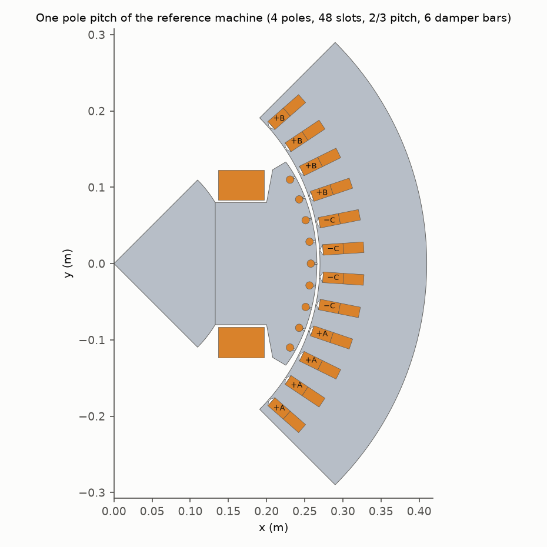

**Parameters** (generated):

<!-- TABLE:params -->
| Parameter (pu on 800 kVA) | Analytic (L1) | FEMM (L2) | Public data sheets 310–1150 kVA [S7] |
|---|---|---|---|
| Xd | 2.386 | 2.196 | 2.44–2.94 |
| Xq | 1.091 | 1.001 | 1.90–2.48 |
| Xl | 0.117 | 0.117 | — |
| X'd | 0.265 | 0.256 | 0.146–0.19 |
| X''d | 0.145 | 0.207 | 0.11–0.13 |
| X''q | 0.131 | 0.160 | 0.24–0.37 |
| T'do (s) | 1.927 | 1.822 | 1.7–4.09 |
| T'd (s) | 0.214 | 0.213 | 0.08–0.097 |
| T''do (s) | 0.032 | 0.037 | — |
| T''d (s) | 0.017 | 0.030 | 0.012–0.019 |
| T''qo (s) | 0.398 | 0.229 | — |
| Ra | 0.011 | 0.011 | — |
<!-- /TABLE -->

**FEMM results** (generated):

<!-- TABLE:femm -->
| Quantity | Value |
|---|---|
| No-load field current for 1 pu (FEMM) | 28.8 A |
| Air-gap-line field current at 1 pu | 26.9 A |
| Line-to-line THD, no load, unskewed | 2.27 % |
| Phase THD (incl. triplen) | 2.27 % |
| Largest line harmonics (% of fundamental) | 5: 1.94 %, 7: 0.99 %, 11: 0.20 %, 13: 0.31 %, 19: 0.25 %, 25: 0.47 % |
| Field self-inductance Lff (4 poles) | 1.798 H |
| Field–phase mutual Lafd | 38.47 mH |
| SSFR fit RMS error, d (field open) / q | 0.46 % / 0.23 % |
| SSFR low-frequency limit vs static solve (linear μr 2000 vs M-19 B-H), d / q | -4.3 % / -1.7 % |
| X''d: damper only (field open) / with field branch | 0.345 / 0.207 |
| T''d / T''do (circuit) | 29.7 ms / 36.8 ms |
<!-- /TABLE -->

**Why FEMM and the analytic design differ** (L1 vs L2, Principle 33.5, p. 718):
- **Xd, Xq (−8 %) and the air-gap-line field current (+7 %).** These are the same effect seen from two sides: FEMM's
  effective air gap is about 7 % larger. FEMM resolves three things the analytic model folds into a Carter factor
  and form factors for an ideal cosine pole:
  - the stator slot openings;
  - the nine 2 mm damper slits in the pole face (D16, D17);
  - the finite iron permeability at the low test currents.
- **X'd (−3 %) and T'do (−5 %).** These are dominated by the field and stator leakage, which both levels compute
  similarly. The end-winding leakage is analytic in both. FEMM's Lff is 1.80 H against 1.90 H analytic.
- **X''d (+43 %) and X''q (+22 %).** The analytic referral (`bta/design.py`, `damper()`) treats the bars as a cage
  spread evenly over the whole pole arc and ignores the slit leakage of each bar. In FEMM the 9 bars cover 83 % of
  the arc and each bar sits under its own slit, so less flux is screened. The 6-bar first run showed the same effect
  more strongly (X''d 0.242 pu, D17). The dynamic model uses FEMM's value, which gives the deeper and more
  conservative first dip.
- **Field-branch combination.** The d-axis subtransient values combine the damper branch from the field-open SSFR
  with the field branch from the static solves, in the classical equal-mutual circuit (no Canay differential
  leakage). The fit errors are 0.46 % (d) and 0.23 % (q). The SSFR low-frequency limit is 4.3 % (d) and 1.7 % (q)
  below the static inductance, because the SSFR uses linear iron (μr = 2000) and the static solve the M-19 B-H curve.
- **T''d.** It is 30 ms here against 12–19 ms on data sheets, because the FEMM end rings have zero resistance.
  Real ring resistance only shortens T''do and T''qo. Halving both (§8.4) deepens the SR-01 dip from −14.68 % to
  −15.05 %. The ideal ring is therefore slightly *optimistic*, and the 0.3-point margin of finding 3 may not survive
  real end rings. Measuring T''d (sudden short circuit, §10.3) is the first test to run.
- **Xq against public data.** Xq/Xd is 0.46 here against about 0.8 on the LV data sheets [S7]. This follows from the
  study design's pole arc (0.68) and wide interpolar gap. It enters the dip through X''q only weakly, and the
  data-sheet-class run in §6.3 brackets it.

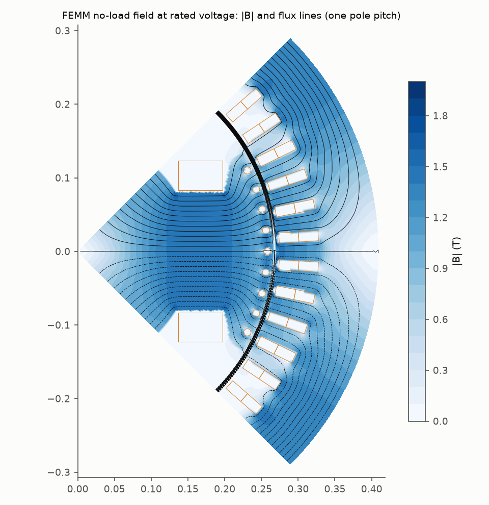
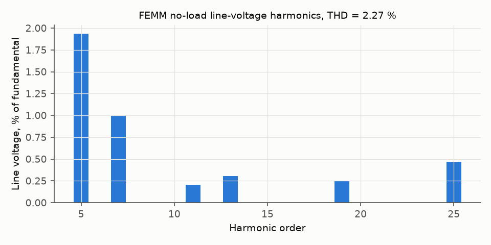
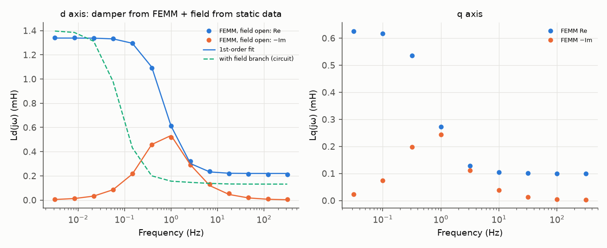

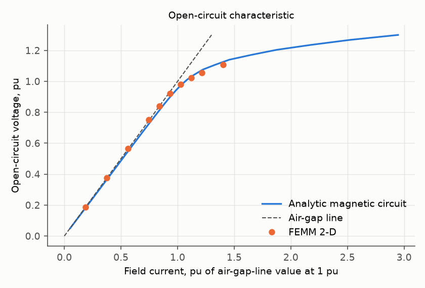

### 6.2 Voltage-dip budget for SR-01 (Principles 31.1–31.4, pp. 667–668)

The −15 % budget is apportioned to causes that the model can switch off one at a time (`scripts/run_studies.py`):
1. **Reactance step.** The dip at t = 0⁺ with all rotor fluxes frozen. It is set by X''d, X''q and the load impedance, i.e. the main-machine design.
2. **Unavoidable flux decay.** The further dip even with an ideal excitation: no ceiling, TE = 5 ms, KC = 0.
3. **Real excitation.** The difference between that ideal and the real ceiling, TE, KC, AVR dynamics and supply.
4. **Engine speed.** Measured separately at a 50 % step, because a turbo-charged engine cannot take 100 % in one step. It is the extra dip in the generating-set run versus the constant-speed run.

Results (generated):

<!-- TABLE:budget -->
| | Reactance step t=0⁺ | Flux decay (ideal excitation) | Real excitation | Total dip | Margin to −15 % | Extra dip from engine speed (50 % step) |
|---|---|---|---|---|---|---|
| A0 | 12.60 | -0.03 | 2.17 | 14.73 | 0.27 | 0.89 |
| A1 | 12.60 | -0.03 | 2.11 | 14.68 | 0.32 | 0.72 |
| A2 | 12.60 | -0.03 | 1.85 | 14.42 | 0.58 | 0.73 |
| A3 | 12.60 | -0.03 | 1.92 | 14.49 | 0.51 | 0.69 |
| A4 | 8.98 | 0.00 | 1.76 | 10.74 | 4.26 | 0.74 |
| A5 | 8.98 | 0.00 | 1.67 | 10.64 | 4.36 | 0.74 |
<!-- /TABLE -->

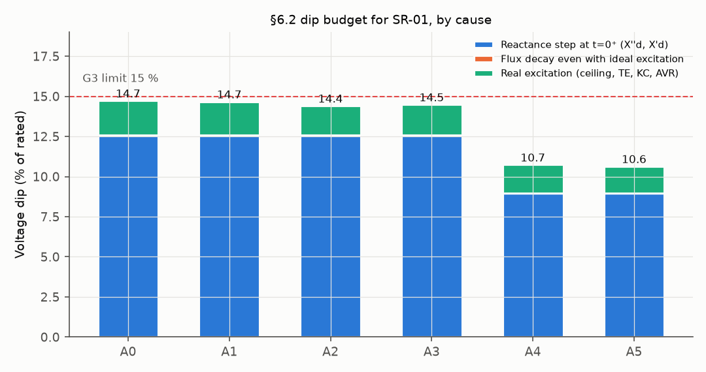

### 6.3 The deciding parameter: X'd

<!-- TABLE:xd -->
| Excitation | Largest X'd meeting SR-01 (−15 %) | Largest X'd meeting SR-05 (132 kW, −20 %) |
|---|---|---|
| A1 shunt | 0.263 | 0.214 |
| A3 PMG | 0.267 | 0.221 |
<!-- /TABLE -->

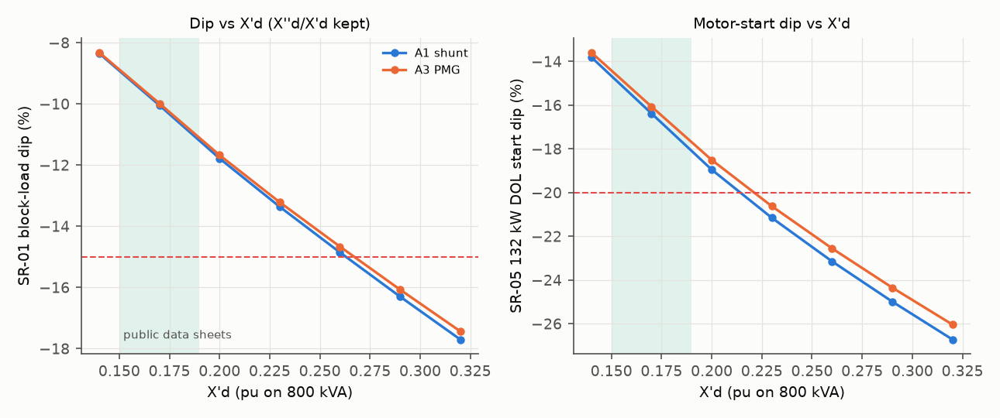

**Robustness check against public data.** A machine with data-sheet-class parameters (midpoints of [S7]) was run with
the same excitation (generated):

<!-- TABLE:ds -->
| Machine | Excitation | SR-01 dip | SR-02 t_U | 132 kW dip |
|---|---|---|---|---|
| Data-sheet class (X'd 0.17) | A1 shunt retuned | -8.45 % | 1.42 s | -16.2 % |
| Data-sheet class | A3 PMG retuned | -8.42 % | 1.42 s | -15.7 % |
<!-- /TABLE -->

## 7. Modeling and simulation ([W] ch. 33)

**Fidelity** (Principle 33.1, p. 706):

| Level | Model | Resolves | Does not resolve |
|---|---|---|---|
| L1 | Analytic design: magnetic circuit, permeances (`bta/design.py`) | Dimensions, OCC, Xd, Xq, X'd, X''d, T'do | Local saturation, slot ripple, true pole leakage |
| L2 | FEMM 4.2, 2-D, one pole pitch with an anti-periodic air-gap element (`femm/`) | OCC, EMF waveform and THD, Ld and Lq, field self and mutual inductance, damper branch from a field-open SSFR (D15) → X''d, T''d, X''q | End effects (added analytically); skew; damper end-ring resistance (ideal rings) |
| L3 | RMS dq dynamics (`bta/dynamics.py`): IEEE 1110 model 2.1, d-axis saturation from the OCC, AC8B/AC8C-type excitation, engine, induction motor | ISO 8528-5 metrics, ceilings, engine speed, motor start, fault current | First-cycle DC offset; waveform during the transient |
| L3b | Detailed rotating rectifier (`bta/rectifier.py`) | Diode commutation; open-diode and short-diode signatures | Exciter magnetic saturation and the exciter's own armature reaction |

**Model validity** ("all models are wrong but some are useful", Principle 33.5, p. 718). Each model is checked against
something independent of itself (`tests/test_models.py`, §10.2).

**Interface choice.** L2 feeds L3 through standard parameters. That is the same interface a test bench produces with
IEC 60034-4-1 tests (§10.3), so the dynamic model can also be fed from measured data later.

## 8. Trade study: analysis of alternatives ([W] ch. 32)

**Charter** (Principle 32.3, p. 689). Find the cheapest change that makes the reference alternator meet SR-01 to SR-06.

**Decision factors and weights** (normalized method, [W] §32.5, pp. 690–695):
- Performance 50: SR-01 dip 15, SR-02 recovery 10, largest motor at 20 % 15, sustained fault current 10.
- Cost 25.
- Risk 15.
- Integration 10.

Utility is linear between the worst and the best alternative. Any "shall" that is not met disqualifies an alternative
before scoring; that is why the scores are shown next to the gate results. Each retuned alternative is tuned on its own
plant by a grid search over KP/KI/KD, with the open-circuit 5 % step overshoot held at 10 % or less (DR-03).

### 8.1 Results per alternative (generated)

<!-- TABLE:aoa -->
| | Alternative | KP/KI/KD | OC overshoot | SR-01 dip | SR-02 t_U | SR-03 rise | SR-04 t_U | SR-05 132 kW dip | Max motor @20 % | SR-06 I_sc at 1 s | Gates |
|---|---|---|---|---|---|---|---|---|---|---|---|
| A0 | Baseline (shunt AVR, textbook PID) | 20.7/10.0/4.6 | 0.0 % | -14.73 % | 5.25 s | +17.0 % | 5.11 s | -23.0 % | 111 kW | 0.04 pu | 2/6 |
| A1 | AVR retuned (shunt) | 30.0/60.0/8.0 | 6.0 % | -14.68 % | 0.97 s | +16.9 % | 1.85 s | -22.9 % | 111 kW | 0.04 pu | 4/6 |
| A2 | Larger exciter + retune | 15.0/60.0/8.0 | 6.5 % | -14.42 % | 2.25 s | +17.3 % | 3.27 s | -22.3 % | 115 kW | 0.04 pu | 4/6 |
| A3 | PMG excitation + retune | 30.0/60.0/8.0 | 8.3 % | -14.49 % | 0.97 s | +16.9 % | 1.85 s | -22.3 % | 115 kW | 2.92 pu | 4/6 |
| A4 | Next frame (oversized) + retune | 30.0/90.0/8.0 | 9.7 % | -10.74 % | 0.72 s | +12.6 % | 1.54 s | -17.4 % | 151 kW | 0.05 pu | 5/6 |
| A5 | Next frame + PMG + retune | 30.0/60.0/8.0 | 8.6 % | -10.64 % | 1.01 s | +12.6 % | 1.73 s | -17.1 % | 156 kW | 3.61 pu | 6/6 |
<!-- /TABLE -->

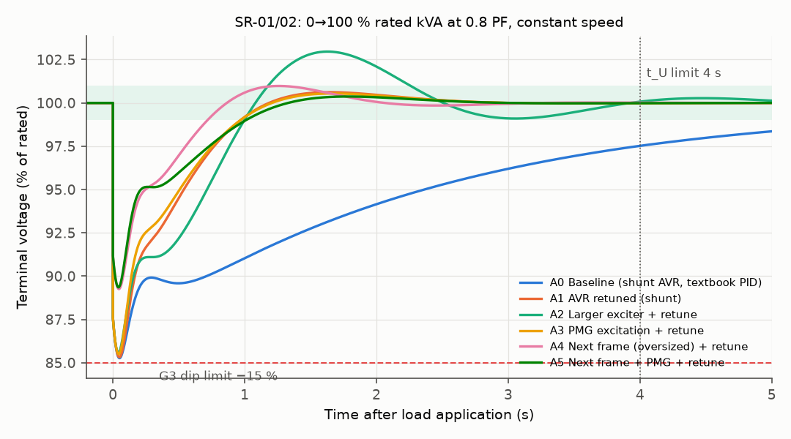
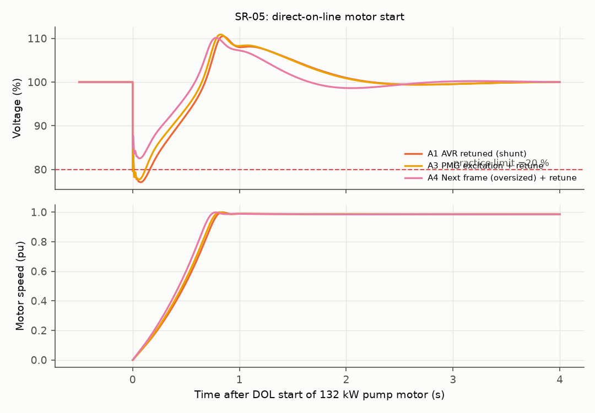
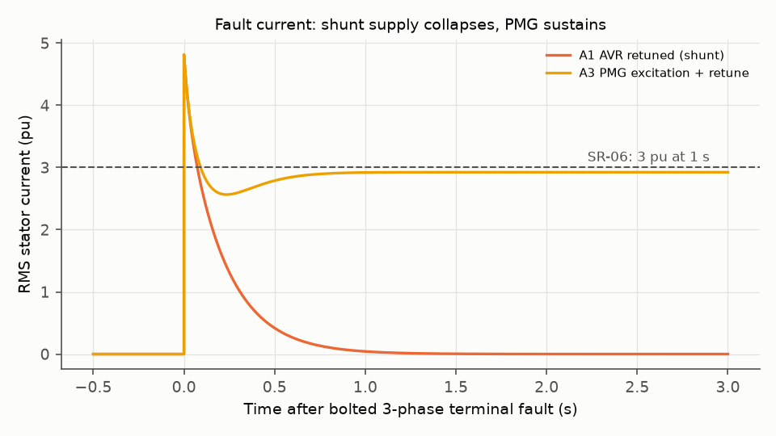

### 8.2 Requirement gates (generated)

<!-- TABLE:gates -->
| Requirement | A0 | A1 | A2 | A3 | A4 | A5 |
|---|---|---|---|---|---|---|
| SR-01 dip | pass | pass | pass | pass | pass | pass |
| SR-02 recovery | **fail** | pass | pass | pass | pass | pass |
| SR-03 rise | pass | pass | pass | pass | pass | pass |
| SR-04 rejection recovery | **fail** | pass | pass | pass | pass | pass |
| SR-05 motor 132 kW | **fail** | **fail** | **fail** | **fail** | pass | pass |
| SR-06 sustained SC | **fail** | **fail** | **fail** | **fail** | **fail** | pass |
<!-- /TABLE -->

### 8.3 Scores and weight sensitivity (generated)

<!-- TABLE:scores -->
| | Cost index [A/D] | Risk [A] | Integration [A] | Weighted score | Won (weights ±50 %) | Meets every shall |
|---|---|---|---|---|---|---|
| A0 | 1.00 | 9 | 10 | 50.0 | 12.2 % | no |
| A1 | 1.00 | 8 | 10 | 44.2 | 1.2 % | no |
| A2 | 1.04 | 8 | 9 | 39.0 | 0.0 % | no |
| A3 | 1.06 | 8 | 8 | 46.1 | 2.1 % | no |
| A4 | 1.25 | 9 | 6 | 60.0 | 82.7 % | no |
| A5 | 1.31 | 8 | 5 | 49.4 | 1.8 % | yes |
<!-- /TABLE -->

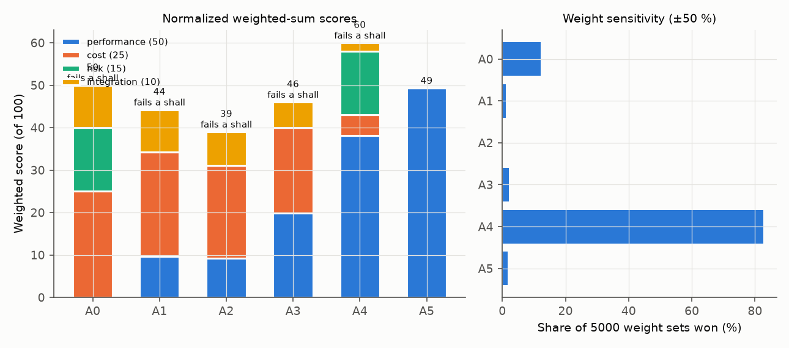

### 8.4 Sensitivity to the assumed physical parameters (A1, generated)

<!-- TABLE:sens -->
| Parameter [A] (low/high) | SR-01 dip low | high | t_U low | high | 132 kW dip low | high |
|---|---|---|---|---|---|---|
| X'd -/+20 % | -13.81 | -16.39 | 0.98 | 0.93 | -21.6 | -25.3 |
| X''d -/+20 % | -13.78 | -15.87 | 1.03 | 0.90 | -22.0 | -24.2 |
| T'do -/+20 % | -14.81 | -14.59 | 0.97 | 0.97 | -23.2 | -22.7 |
| T''do, T''qo x0.5/x1 (end-ring R) | -15.05 | -14.68 | 0.92 | 0.97 | -23.6 | -22.9 |
| Exciter TE 0.15/0.40 s | -14.19 | -15.25 | 1.00 | 1.63 | -22.0 | -24.1 |
| Rectifier KC 0.08/0.25 | -14.61 | -14.78 | 0.95 | 0.99 | -22.8 | -23.1 |
| Ceiling VRMAX 10/18 | -15.24 | -14.38 | 0.91 | 1.02 | -24.3 | -22.3 |
| Sensing TR 5/30 ms | -14.65 | -14.81 | 0.96 | 1.02 | -22.9 | -23.0 |
| Motor Rr locked 0.035/0.070 | -14.68 | -14.68 | 0.97 | 0.97 | -24.0 | -21.2 |
| *A1 base* | -14.68 | | 0.97 | | -22.9 | |
<!-- /TABLE -->

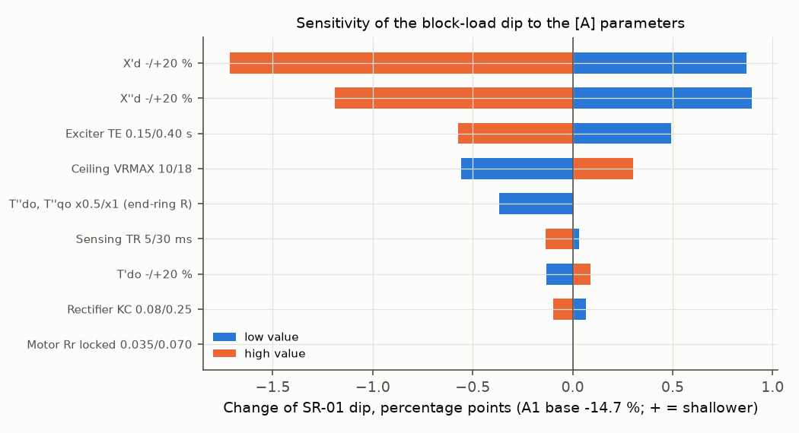

### 8.5 Trade study report: recommendation (Principle 32.9, p. 698: recommendations, not decisions)

These are recommendations to the decision maker, not decisions (Principle 32.9).

1. **If SR-05 (a 132 kW DOL start within −20 %) and SR-06 (3 pu at 1 s) stay as written: A5**, the next frame with
   a PMG and a retuned AVR. It is the only alternative that meets all six shalls, at a cost index of 1.31.
   - A4 scores highest and wins 83 % of the weight draws, but it fails SR-06. This is why the gates come before the
     scores.
2. **Challenge SR-05 before buying the frame** ([W] ch. 19, requirement validation). If the largest motor is held
   at 111 kW, or the 132 kW pump gets a soft starter, A3 meets every shall except SR-06. A3 is the PMG with a
   retuned AVR, at a cost index of 1.06. SR-06 is then met with a 4.4 % higher AVR ceiling. This saves about a fifth
   of the alternator cost index against A5.
3. **Study one more alternative before committing to the next frame: a base-frame redesign for X'd ≤ 0.21 pu.**
   Public 310–1150 kVA data sheets show X'd = 0.146–0.19 pu, and the data-sheet-class run passes SR-01 with
   6.5 points of margin. X'd here is mostly leakage (field-pole leakage and stator slot leakage), so the levers are
   the pole and slot geometry, not the frame size. This alternative was not in the charter and is not scored.
4. **In every case**, retune the AVR with the DR-03 rule, since the textbook tuning fails SR-02. Also fit a
   rotating-diode monitor (1×/6× f_ex): on the base frame a single open diode is enough to break SR-01 without any
   alarm.

## 9. Reliability: FMEA ([W] ch. 34)

**Definitions** (MIL-HDBK-470A as quoted in [W] §34.3.8, pp. 761–762):
- failure mode: "the consequence of the mechanism through which the failure occurs";
- effects at three levels: local, next higher level, end.

Severity (S), occurrence (O) and detection (D) are rated 1–10 [A]; RPN = S·O·D. Items marked ▲ are quantified by
simulation.

| ID | Item / failure mode | Local effect | Next higher level | End effect | Detection | S | O | D | RPN | Mitigation |
|---|---|---|---|---|---|---|---|---|---|---|
| FM-01 ▲ | Rotating diode open | One phase of the exciter armature conducts half-wave; DC component in the armature currents | Rectifier capability drops (factor in the table below); AVR raises the exciter field current | Set still runs; deeper and slower transients (below); hidden failure | Exciter field current component at f_ex [D], [S11][S13] | 5 | 3 | 7 | 105 | Diode monitor on exciter field current (1×f_ex / 6×f_ex ratio, [S12]); routine bench check |
| FM-02 ▲ | Rotating diode short | Exciter armature line-to-line short each cycle | Armature current ×2.9, capability about halved; AVR at or near ceiling | Exciter overheating, then loss of excitation; collapse on the next large step | Same signature, much larger [D], [S12] | 8 | 2 | 6 | 96 | Same monitor with a trip; varistor/surge suppressor on the rectifier |
| FM-03 | AVR sensing lost (open fuse or wire) | AVR sees 0 V | Regulator drives to ceiling | Over-voltage on all loads | Over-voltage relay | 9 | 2 | 3 | 54 | Sensing-loss detection in the AVR; over-excitation protection |
| FM-04 | PMG failure (A3/A5 only) | No AVR supply | Excitation lost | Voltage collapse, set trips | Under-voltage relay | 8 | 1 | 2 | 16 | PMG fault alarm; robust PMG mounting |
| FM-05 | Loss of remanence (shunt only) | No build-up | Set cannot excite | Failed start (mission failure) | Start sequence time-out | 7 | 2 | 2 | 28 | Field flashing; PMG option removes it |
| FM-06 | Damper bar crack | Damper resistance up | X''d, T''d change | Slightly deeper first dip; local heating at the crack | Rotor inspection | 4 | 2 | 8 | 64 | Bar/ring brazing inspection |
| FM-07 | Field inter-turn short | Lower field ampere-turns per amp; unbalanced pole MMF | Higher field current at load; magnetic pull imbalance | Vibration, field overheating | Field current vs load trend; vibration | 6 | 2 | 6 | 72 | Routine field resistance and impedance (pole-drop) test |
| FM-08 | Exciter field open | No exciter output | Excitation lost | Collapse | AVR output check | 8 | 1 | 2 | 16 | Exciter field resistance check in the routine test |
| FM-09 | Main stator insulation fault | Earth fault | Protection trips | Outage | Earth-fault relay; IR test | 9 | 2 | 3 | 54 | IR/PI and HV tests (routine test) |
| FM-10 | Over-tuned AVR (configuration) | Oscillatory voltage | Fails SR-02/04; can hunt with the engine | Flicker, trips | OC step test | 5 | 3 | 3 | 45 | DR-03 tuning rule; OC step test in commissioning |

**Diode failure, quantified** (generated; `bta/rectifier.py` + dynamic model with the rectifier capability factor):

<!-- TABLE:diode -->
| Rectifier state | Mean DC voltage (V) | Capability factor | Max armature current vs healthy | Field-frame MMF at f_ex (A) | at 6 f_ex (A) | ratio 1/6 | SR-01 dip | SR-02 t_U | 132 kW dip |
|---|---|---|---|---|---|---|---|---|---|
| Healthy | 51.1 | 1.000 | 1.00 | 0.01 | 8.98 | 0.002 | -14.68 % | 0.97 s | -22.9 % |
| One diode open | 39.1 | 0.765 | 1.06 | 29.31 | 5.30 | 5.530 | -15.02 % | 1.11 s | -23.7 % |
| One diode shorted | 26.3 | 0.515 | 2.90 | 99.20 | 2.36 | 41.946 | -15.67 % | 1.54 s | -25.3 % |
<!-- /TABLE -->

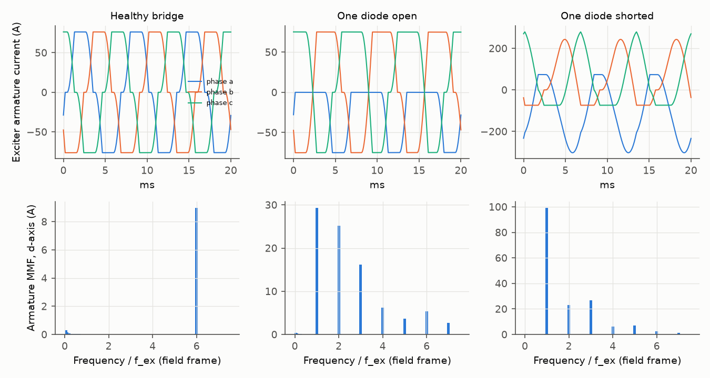

The detailed rectifier model (healthy case, negligible armature resistance) reproduces the classical six-pulse result
with commutation overlap, V_dc = (3√2/π)·V_LL − (3/π)·X_c·I, within 1 % (test
`test_healthy_bridge_dc_voltage_matches_commutation_formula`).
A failed diode puts a component at the exciter frequency f_ex into the field-frame armature MMF, and the
1×f_ex / 6×f_ex ratio rises sharply. This matches the detection principle of [S12] and the field-current signatures
reported in [S11][S13]. Only frequencies and relative changes are claimed: the amplitude reaching the exciter field
current depends on the field circuit and the AVR, which were not modelled.

## 10. Verification and validation ([W] ch. 13, 28)

Verification asks "built right to the spec?" (Principle 13.3, p. 275). Validation asks "right system for the need?"
(Principle 13.4, p. 275). Following Principles 13.11–13.12 (p. 283) and 28.3 (p. 608), one test should verify several
requirements.

### 10.1 Verification matrix

| Req. | Method in this study | Evidence | Method on a real machine |
|---|---|---|---|
| SR-01, SR-02 | Analysis (L3) | §8.1, `results/aoa_femm.json` | Load-bank test: 100 % 0.8 PF step on the bench (one test verifies both) |
| SR-03, SR-04 | Analysis | §8.1 | Same test, load rejection |
| SR-05 | Analysis | §8.1, max-motor search | Motor-start test or a low-PF load-bank simulation (ISO 8528-3:2020 Annex A.3 "motor starting loads" [S3]) |
| SR-06 | Analysis | §8.1 | Sustained three-phase short-circuit test |
| SR-07 | Analysis (FEMM L2) | §6.1 | Waveform measurement at no load (IEC 60034-1 cl. 9.11.3 [S4]) |
| SR-08 | Not analysed (steady state) | — | Regulation test (sister bench check "AVR regulation") |

### 10.2 Model verification (each against an independent result; `tests/test_models.py`)

| Check | Independent reference | Result |
|---|---|---|
| Winding factors, 2/3 pitch kills the 3rd harmonic | Closed form | pass |
| Steady states are steady (no load, 0.8 PF, unity PF) | Definition | pass |
| Voltage at t = 0⁺ of a step | Closed form with frozen fluxes: V = 1/\|1 + Z''·Y\| | within 0.01 pu |
| Induction-motor model | Textbook equivalent circuit at 4 slips | exact (1e-9) |
| Shunt collapses / PMG sustains fault current | Data-sheet statement [S7] | reproduced |
| Rectifier average voltage (R → 0) | Six-pulse commutation formula | within 1 % |
| Rectifier fault ratio 1×/6× f_ex rises with the fault | Detection principle [S12] | reproduced |
| L1 analytic vs L2 FEMM | Independent method | §6.1 table |
| SSFR low-frequency limit vs static Ld, Lq | Two FEMM routes (time-harmonic linear iron vs magnetostatic B-H) | §6.1 FEMM table |

### 10.3 Bench test plan (links to the sister project *alternator-routine-test-station*)

The sister project simulates the routine-test bench. Its 800 kVA "medium" frame has the same rating as this machine.
This model provides the expected values that bench checks compare against, and it adds the type tests needed to
measure the model inputs:

| Test | Standard clause [S10] | Measures | Model input or output |
|---|---|---|---|
| Open-circuit characteristic | IEC 60034-4-1 6.4 / 7.2.1 | OCC, no-load field current | Saturation table; bench check "no-load field current" |
| Sustained short-circuit characteristic | 6.5 / 7.2.1 | Xd (unsaturated) with the OCC | Xd |
| Sudden three-phase short circuit | 6.11 / 7.1.2, X'd 7.3.1, X''d 7.4.1, T'd 7.16.1, T''d 7.18 | Transient and subtransient quantities | X'd, X''d, T'd, T''d (validates L2) |
| Low-slip test | 6.10 / 7.5.2 | Xq | Xq |
| Standstill frequency response | 6.27 / 7.28.3, Annex B | Operational inductances Ld(jω), Lq(jω) | Direct comparison with the FEMM SSFR curve |
| DC decay at standstill | 6.14 / 7.1.4 | Time constants | T'do |
| Load-bank transient test | ISO 8528-5 / -3 | δU_dyn, t_U | Validation of L3 (SR-01/02) |

[S10] notes that brushless machines "require special effort for some of the tests": there is no slip-ring access to
the main field. So the SSFR and sudden-short-circuit tests are type tests on an instrumented rotor, not routine tests.

### 10.4 Validation

Validation means operational test and evaluation by the user (Principle 13.14, p. 289). It needs the generating-set
packager's own load-acceptance test with the real engine, recorded against UC-1 to UC-3. The engine model here is
generic [A]. Its effect (§6.2, last column) is therefore a sensitivity, not a validated prediction.

## 11. Assumed versus sourced, and limits

**Sourced [S].** The following come from sources:
- ISO 8528-5 G3 values (through two white papers) and the recovery-band definition.
- IEEE 421.5 model structures, the FEX function and the shunt/PMG supply switch.
- The IEC 60034-4-1 test clauses.
- The public data-sheet parameter ranges.
- Motor-starting practice values.
- The qualitative behaviour of shunt vs PMG excitation.
- The diode-failure detection principles.
- The FEMM semantics used for damper bars and the shorted field [T7].

**Derived [D].** Everything computed by the code in this repository.

**Assumed [A], and where it matters:**
- **Geometry.** The machine is a study design, not a product. Its X'd (§6.1) sits **above** the public data-sheet range of 0.146–0.19. §6.3 shows the conclusion depends on exactly this, which is why the X'd threshold, not the specific machine, is the main result.
- **Excitation parameters** TE, KC, KD, SE points and the 6 A AVR forcing current behind VRMAX: §8.4 varies them.
- **Engine model** (droop, lags, turbo-lag fuel limit): it only enters §6.2's engine column.
- **Cost, risk and integration scores:** varied in the weight Monte Carlo. The cost of the next frame is derived from the active-volume ratio.
- **The 132 kW motor and its parameters:** the starting PF follows from the parameters (0.34 at locked rotor, within the 0.3–0.5 of [S8]).

**Limits:**
- 2-D FEMM without skew or end effects; the end-winding leakage comes from the analytic model.
- Damper end rings are ideal in FEMM. §8.4 bounds the effect: halving T''do and T''qo breaks SR-01 (−15.05 %).
- RMS dynamics only, so no first-cycle offset.
- One design point.
- The textbook equations [T1]–[T5] are derived in `docs/design_notes.md` but their equation numbers were not re-checked against the books.

## 12. Decision log

| # | Decision | Alternatives considered | Rationale |
|---|---|---|---|
| D1 | Reference machine 800 kVA, 400 V, 4-pole | Smaller or larger frames | Same rating as the sister bench project's "medium" frame, so this model can give that bench its expected values |
| D2 | 2/3-pitch double-layer winding, q = 4 | 5/6 pitch | Removes the 3rd harmonic, the usual choice for LV generating sets with loaded neutrals |
| D3 | RMS (phasor-dynamics) fidelity for L3 | Full EMT (stator transients, diode switching) | ISO 8528-5 limits apply to the RMS envelope. EMT would add first-cycle detail at about 100× the runtime ([W] Principle 33.1) |
| D4 | IEEE 421.5 AC8B structure with the AC8C SW1 supply switch | AC1A, AC5A | PID AVR + brushless exciter + FEX matches a digital LV AVR. SW1 is the shunt/PMG question of the trade study [S1] |
| D5 | VRMAX = 14 pu (derived from an assumed 6 A AVR forcing current) | 8 pu (first estimate) | The first estimate came from the exciter-field voltage, not current. 14 pu reproduces the about 3 pu PMG fault current that data sheets show |
| D6 | Requirement SR-01 applied to a full 100 % step | ISO's BMEP-based step | Mission assumption for a critical-facility standby set. It is stricter than ISO, stated as [A] |
| D7 | AVR tuning by an auditable grid search with an OC-overshoot ≤ 10 % rule | Optimiser; pole cancellation only | A grid is reproducible and shows the trade-off. Pole cancellation alone left a slow integral tail under load |
| D8 | Rotor geometry changed to pole body 160 mm, 15 mm² edge-wound strip | 180 mm body, 18 mm² wire | The 2-D section showed the 18 mm² coil did not fit between the poles (`bta/geometry.check_section`) |
| D9 | FEMM rotor rotation by an anti-periodic air-gap element | Re-meshing per position | No remeshing noise in the waveform; one model for all positions [T7] |
| D10 | FEMM solver run visible, at above-normal priority | Minimised window | A minimised solver was throttled by the OS on a busy workstation (observed 10 % CPU duty) |
| D11 | Next-frame alternative designed with the same code, FEMM correction carried over | Scale per-unit values by kVA | Keeps the comparison like-for-like and traceable to geometry |
| D12 | Cite only three neutral public data sheets | Four sheets | Keeps company and product names of prospective employers out of the repository |
| D13 | THF not computed | Compute with a remembered weighting table | The THF weighting table could not be verified, and the current IEC 60034-1 contents list clause 9.11 as THD, not THF [S4]. So only THD is claimed |
| D14 | SSFR in FEMM with linear iron, μr = 2000 [A] | Nonlinear iron in the time-harmonic solver | SSFR is a small-signal test at a few % of rated current. The nonlinear harmonic solve needed minutes per point with no physical gain |
| D15 | SSFR with the field OPEN and the bars joined by ideal end rings (bar connection: see D17). The field branch comes from the static FEMM solutions (Lff, Lafd) and the design resistance, combined in the d-axis circuit | Field modelled as one solid shorted loop | The first SSFR run with a solid-loop field gave Ld = 0.135 mH flat above 1 Hz, and X''q ≈ X'q. The solid loop crowds eddy currents to the coil edges and screens like an extra damper, which a stranded coil cannot do. (A remark in an earlier draft that unconnected bars left the q-axis damper inactive came from the closed-bridge geometry of D16 and is withdrawn; see D17.) The raw first run is kept as `femm/out/prelim_closed_damper_slots/ssfr_field_solid_loop.csv` |
| D16 | Damper bars in semi-open slots (2 mm slit to the pole surface) | Bars fully enclosed under a 3 mm iron bridge | With a closed bridge and linear iron, the bridge carried the flux around the cage: the bar-to-bar flux difference was about 1000× smaller than the pole flux, and X''d ≈ X'd. Real amortisseur slots are semi-open, and the analytic damper permeance already assumed the 2 mm opening. The closed-slot results are kept in `femm/out/prelim_closed_damper_slots/` |
| D17 | 9 damper bars per pole (8 pitches of 0.85 slot pitch = 83 % of the pole arc), each bar shorted by an ideal continuous end ring (FEMM block with no circuit) | 6 bars (52 % of the arc); all bars of the pole in one zero-net-current parallel circuit | The full FEMM run with 6 bars gave X''d = 0.242 pu against X'd = 0.257 pu and X''q = 0.90 pu: the outer half of the pole face had no damper, while the analytic model treats the cage as spread over the whole arc. The zero-net constraint is also wrong for the q axis: there the bar currents of one pole have the same sign and return through the ring to the next pole. Under anti-periodic symmetry an ideal continuous ring forces the common bar voltage to zero, which is exactly a no-circuit block (J = −jωσA). A quick check at 100 Hz (2-D inductance, `femm/out/damper_check_6v9_bars.txt`): d axis 0.531 → 0.190 mH (6 → 9 bars, same for both connections); q axis 0.388 mH (parallel circuit) vs 0.078 mH (no circuit). The 6-bar results are kept in `femm/out/prelim_6bars_zero_net/` |

## 13. References

- **[W]** C. S. Wasson, *System Engineering Analysis, Design, and Development: Concepts, Principles, and Practices*, 2nd ed., Wiley, 2016. Chapters 4–7, 13, 19–22, 26–28, 31–34.
- **[S1]** IEEE Std 421.5-2016. Read through public implementations:
  - AC8B: CIM ExcIEEEAC8B, https://acs.pages.rwth-aachen.de/public/cim/cimpy/cimpy.cgmes_v2_4_15.ExcIEEEAC8B.html
  - AC8C, switch SW1: MathWorks, https://www.mathworks.com/help/sps/ref/smac8c.html
  - IN, FEX: GridKit EXAC1, https://gridkit.readthedocs.io/en/latest/GridKit/Model/PhasorDynamics/Exciter/EXAC1/README.html
- **[S2]** ISO 8528-5:2018. Contents (clause 15) and definitions 3.32–3.33 from the public sample, https://cdn.standards.iteh.ai/samples/71009/8a656586f1e44760a70afec399718590/ISO-8528-5-2018.pdf
- **[S3]** ISO 8528-3:2020 (Annex A.3) and ISO 8528-3:1993 (8.8 tolerance band), public samples at cdn.standards.iteh.ai (samples 77444, 15759).
- **[S4]** IEC 60034-1:2022 contents, clause 9.11 "THD for synchronous machines" (public preview, webstore.iec.ch / iteh sample 103428).
- **[S5]** Manufacturer white paper, "ISO 8528-5 and Generator Transient Performance" (2022 edition values), https://techcomm.kohler.com/techcomm/pdf/ISO%208528-5%20and%20Generator%20Transient%20Performance_WP.pdf
- **[S6]** Manufacturer white paper on generating-set performance classes (2018 edition values), https://mart.cummins.com/imagelibrary/data/assetfiles/0058629.pdf
- **[S7]** Three public LV alternator data sheets, 310–1150 kVA, 400 V 50 Hz (reactances, time constants, motor-starting curves, self-excited short-circuit note); URLs and values in `docs/sources_datasheets.md`.
- **[S8]** Manufacturer white paper TP-103, "Sizing generators for motor starting" (starting PF 0.3–0.5, NEMA code letters), https://resources.kohler.com/power/kohler/industrial/pdf/Sizing_Generators_for_Motor_Starting_WP.pdf
- **[S9]** L. A. Bey, "Sizing gensets for large motor starting", EC&M, https://www.ecmweb.com/basics/article/20885994/sizing-gensets-for-large-motor-starting
- **[S10]** IEC 60034-4-1:2018. Contents, scope and clause numbers from the public preview, https://assets.vde-verlag.de/iec-normen/preview-pdf/info_iec60034-4-1%7Bed1.0%7Db.pdf
- **[S11]** M. A. McArdle, D. J. Morrow, "Noninvasive detection of brushless exciter rotating diode failure", IEEE Trans. Energy Conversion, 2004, doi:10.1109/TEC.2003.822325 (abstract).
- **[S12]** US Patent 9,910,083 B2: rotating diode failure detection using the ratio of exciter field current harmonics.
- **[S13]** Tian et al., brushless exciter diode failure, SDEMPED 2021 (abstract): a failed diode raises the exciter field current and unbalances the armature currents.
- **[S14]** Dealer application note, "Motor start concerns": a PMG does not significantly reduce the initial dip, https://www.toromontpowersystems.com/pdf/ConsultantsCorner/Motor%20Start%20Concerns.pdf
- **[T1]** J. Pyrhönen, T. Jokinen, V. Hrabovcová, *Design of Rotating Electrical Machines*, 2nd ed., Wiley, 2014.
- **[T2]** I. Boldea, *Synchronous Generators*, 2nd ed., CRC Press, 2016.
- **[T3]** P. Krause et al., *Analysis of Electric Machinery and Drive Systems*, 3rd ed., Wiley-IEEE, 2013.
- **[T4]** P. Kundur, *Power System Stability and Control*, McGraw-Hill, 1994 (§3.8 saturation, §4.2 parameter relations, §7.2 induction motors).
- **[T5]** IEEE Std 1110-2019, guide for synchronous generator modeling practices (model 2.1 structure).
- **[T6]** MIL-HDBK-470A, as quoted in [W] §34.3.8.
- **[T7]** D. Meeker, *FEMM 4.2 User's Manual*, §2.2.7 "Circuit properties" (pp. 32–33: parallel circuits; conductors without a circuit are "shorted together at infinity"), and the Lua command reference for anti-periodic air-gap elements (p. 90–91). The copy installed with FEMM.
