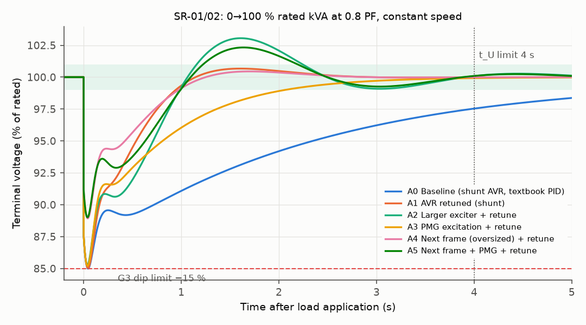

# Alternator transient performance vs ISO 8528-5 G3

**Question.** Can an 800 kVA, 400 V, 4-pole brushless alternator with its exciter and AVR meet the ISO 8528-5
**G3** voltage limits (−15 % dip, 4 s recovery) on a full block load and on a direct-on-line motor start? Which
design or AVR parameter decides it?

The study runs geometry → field solution → machine parameters → dynamics → trade study, following a
systems-engineering spine:
- need, ConOps, modes, requirements, architecture;
- budgets, analysis of alternatives, modeling and simulation, FMEA;
- verification and validation.

The full report is in **[DOSSIER.md](DOSSIER.md)** (also as [DOSSIER.pdf](DOSSIER.pdf)).

**Answer (FEMM-derived parameters, real end rings).** The machine meets the G3 block-load dip with no margin:
−14.95 % against −15 %, a margin of 0.05 points, and the textbook AVR tuning fails it at −15.01 %. It meets the
4 s recovery once the AVR is retuned (0.94 s). It fails:
- the 132 kW direct-on-line motor start: −23.4 % against −20 %;
- with shunt excitation, the 3 pu sustained fault current.

The deciding parameter is **X'd**: 0.256 pu, against the 0.207 pu the motor start needs. The AVR, exciter and PMG move
the first dip by at most 0.3 points; 12.7 of the 14.95 points are already there at t = 0⁺. Only the next frame with a
PMG meets every requirement. A base-frame redesign (8 mm air gap, shallower slots) reaches the motor start by
0.1 points at +28 % field current. The dossier recommends challenging the motor requirement first. One open rotating
diode is enough to break the dip limit without any alarm; the study gives its signature on the stationary side.



## What is in it

| Level | What | Where |
|---|---|---|
| Design | Analytic salient-pole design: winding, cosine-shaped pole, magnetic circuit, reactances, time constants | `bta/design.py`, `docs/design_notes.md` |
| Field | FEMM 4.2 2-D model of one pole pitch with an anti-periodic air-gap element: OCC, EMF waveform and THD, Ld/Lq, field inductances, standstill frequency response (SSFR) | `femm/femm_model.py`, `femm/reduce.py` |
| Dynamics | dq machine (IEEE 1110 model 2.1) with saturation, IEEE 421.5 AC8B/AC8C-type brushless excitation (shunt or PMG supply), diesel engine with droop and turbo lag, deep-bar induction motor | `bta/dynamics.py` |
| Metrics | ISO 8528-5 transient voltage/frequency deviation and recovery time | `bta/metrics.py` |
| Trade study | Six alternatives: AVR retune, larger exciter, PMG, next frame, combination. Per-alternative PID tuning, requirement gates, weighted scores, weight Monte Carlo | `bta/aoa.py`, `scripts/run_aoa.py` |
| Budgets and sensitivity | Dip budget by cause, tornado of assumed parameters, X'd threshold sweep | `scripts/run_studies.py` |
| Reliability | Detailed rotating rectifier: open- and short-diode signature and effect on the G3 margin | `bta/rectifier.py` |
| Verification | Each model checked against an independent result (closed forms, the equivalent circuit, the commutation formula, published behaviour) | `tests/test_models.py` |

## Results (generated from `results/*.json`)

<!-- TABLE:aoa -->
| | Alternative | KP/KI/KD | OC overshoot | SR-01 dip | SR-02 t_U | SR-03 rise | SR-04 t_U | SR-05 132 kW dip | Max motor @20 % | SR-06 I_sc at 1 s | Gates |
|---|---|---|---|---|---|---|---|---|---|---|---|
| A0 | Baseline (shunt AVR, textbook PID) | 20.7/10.0/4.6 | 0.0 % | -15.01 % | 5.24 s | +16.6 % | 5.12 s | -23.4 % | 106 kW | 0.04 pu | 1/6 |
| A1 | AVR retuned (shunt) | 30.0/60.0/8.0 | 8.1 % | -14.95 % | 0.94 s | +16.6 % | 1.83 s | -23.4 % | 111 kW | 0.04 pu | 4/6 |
| A2 | Larger exciter + retune | 15.0/60.0/8.0 | 5.7 % | -14.73 % | 2.24 s | +16.9 % | 3.26 s | -22.8 % | 111 kW | 0.04 pu | 4/6 |
| A3 | PMG excitation + retune | 30.0/30.0/8.0 | 9.5 % | -14.80 % | 2.06 s | +16.6 % | 1.54 s | -22.9 % | 111 kW | 2.92 pu | 4/6 |
| A4 | Next frame (oversized) + retune | 30.0/60.0/8.0 | 8.8 % | -11.07 % | 0.97 s | +12.4 % | 1.70 s | -18.0 % | 147 kW | 0.05 pu | 5/6 |
| A5 | Next frame + PMG + retune | 15.0/60.0/8.0 | 8.2 % | -10.99 % | 2.19 s | +12.4 % | 3.18 s | -17.7 % | 147 kW | 3.61 pu | 6/6 |
<!-- /TABLE -->

## Run it

```bash
pip install -r requirements.txt
python -m pytest -q                       # model verification
python -m scripts.run_aoa --femm          # trade study on FEMM parameters
python -m scripts.run_studies --femm      # dip budget, sensitivity, X'd sweep, diode FMEA
python -m scripts.check_a3_ceiling        # AVR ceiling the PMG option needs for 3 pu fault current
python -m scripts.screen_redesign         # base-frame redesign screen for a lower X'd (DOSSIER §8.6)
python -m scripts.make_figures --femm
python -m scripts.make_tables femm        # writes the tables into DOSSIER.md and README.md
```

**FEMM studies** (Windows, FEMM 4.2 and `pyfemm`): `python femm/femm_model.py occ wave ldq field ssfr`, then
`python femm/reduce.py`. CI does not run FEMM. It re-reduces the cached CSVs in `femm/out/` and re-runs everything
else.

## Assumptions and limits

The machine is a study design, not a product. Every value in the dossier is tagged as sourced, derived or assumed,
and every assumption that can change a conclusion is varied (DOSSIER §8.4, §11). Standards that are behind paywalls
(ISO 8528-5, IEC 60034-1/-4-1, IEEE 421.5) were read through their public previews and public implementations, as
listed in the references.

Sister project: [alternator-routine-test-station](https://github.com/chad416/alternator-routine-test-station).
It is the factory routine-test bench whose checks this model can provide expected values for (DOSSIER §10.3).

MIT licence.
